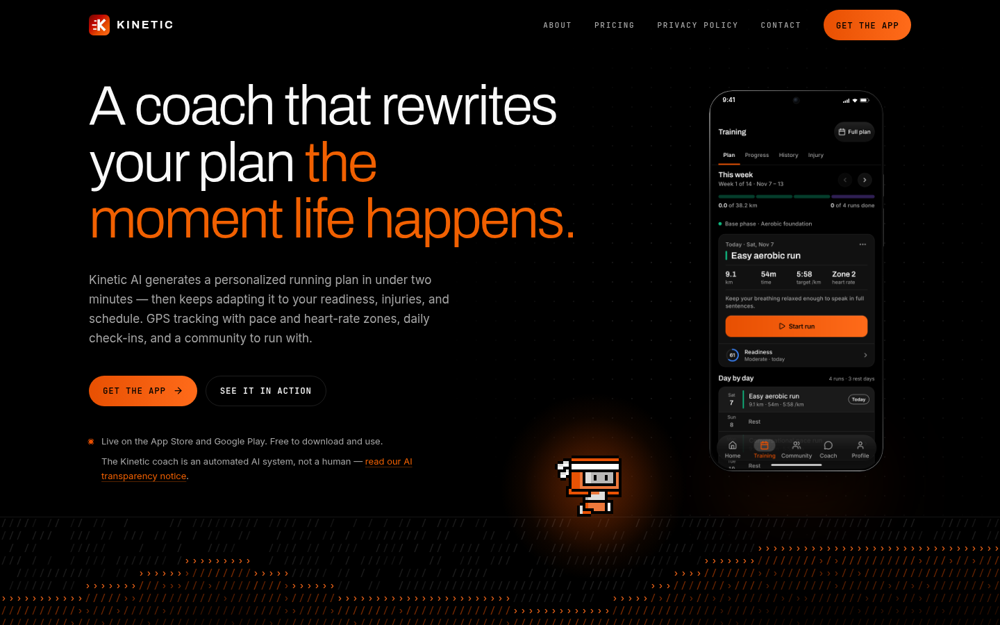
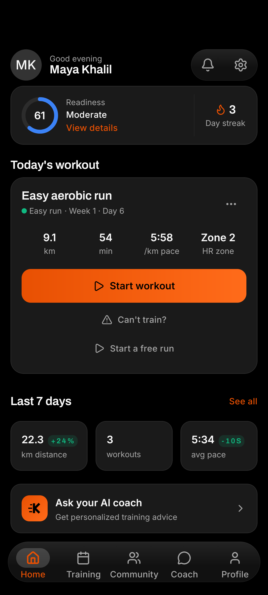
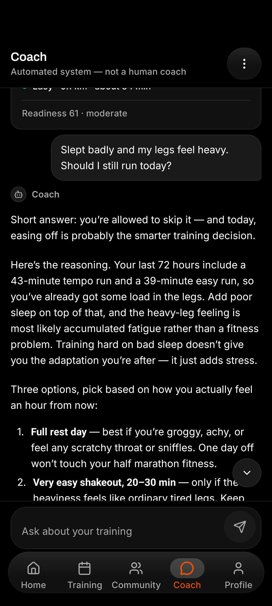

# Kinetic AI: AI Running Performance Director

**Live:** https://kineticai.run

An AI coach for runners. It builds training plans, tracks workouts and runs daily readiness check-ins. Every suggestion is checked against injury-safety rules first, and the runner reviews it before anything is applied.

  
  

## Features
- AI-generated training plans that adapt to readiness, sleep and fatigue
- AI Coach chat, workout tracking and readiness check-ins
- Safety layer: injury and contraindication rules checked before any recommendation
- Web app plus iOS/Android app (Expo), community features, first-run tour

## My role: security
- Ran the security audit, including an **OWASP ZAP** scan, and fixed the findings
- Wrote **cross-user access (IDOR)** and **mass-assignment** tests: user B can't read, change or delete user A's data, and request fields can't set server-owned values
- Hardened auth: a password reset ends all sessions, and reset and refresh tokens are stored hashed
- Resolved client IPs through a trusted proxy, checked uploaded files by their real content type, and hid API docs and debug logs in production
- Added secret scanning (gitleaks), a weekly dependency audit, and signed OTA update support

## Tech stack
Python · FastAPI · React · Expo (React Native) · Docker · AWS App Runner · pytest · OWASP ZAP · Semgrep · Bandit

> **Source code is private** (client/team project). This page shows what was built and the result. Happy to walk through the code and architecture in an interview.
